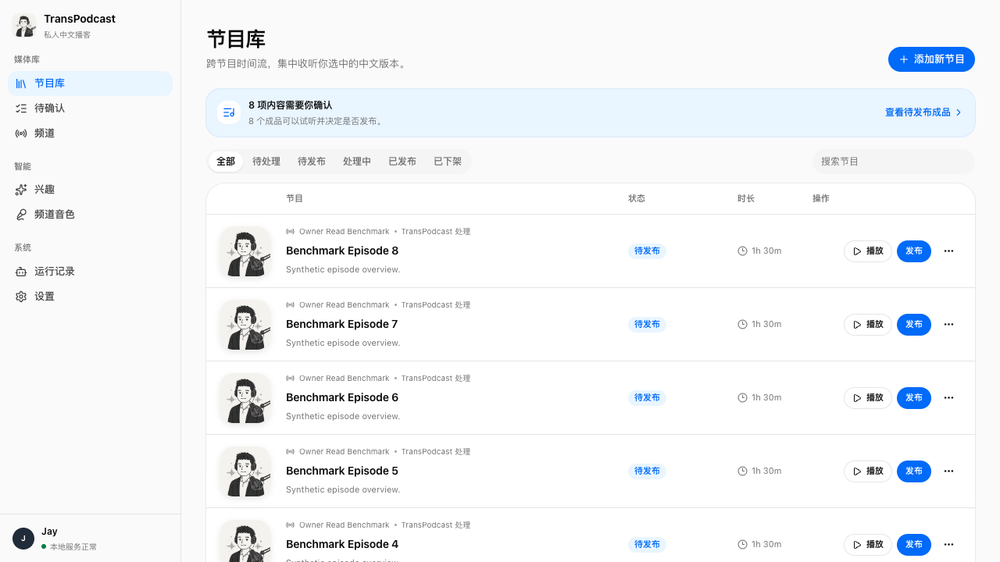
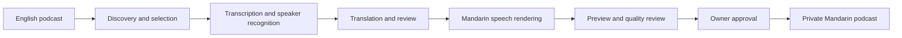

# TransPodcast

<p align="center">
  
</p>

<p align="center">
  <strong>A podcast translation tool that turns English podcasts into Mandarin while preserving each speaker's voice and delivery.</strong>
</p>

<p align="center">
  <a href="README.md">中文</a>
  ·
  <a href="https://github.com/socekin/TransPodcast/actions/workflows/ci.yml"></a>
  <a href="https://github.com/socekin/TransPodcast/actions/workflows/codeql.yml"></a>
  <a href="LICENSE.md"></a>
  
  
</p>

TransPodcast is designed for listeners who want to follow complete long-form
English podcasts in Mandarin. It imports YouTube podcast URLs, recognizes
multiple speakers, translates the full conversation, renders Mandarin speech,
and produces a private podcast that can be followed in Apple Podcasts and
other podcast clients.



## Features

- **Complete episode translation:** Transcribe, translate, and render complete
  long-form podcasts instead of producing only summaries or text.
- **Multi-speaker voice preservation:** Identify individual speakers and
  preserve their voice characteristics and delivery in the Mandarin edition.
- **Translation and review:** Translate with full-episode context and run an
  independent review for terminology, numbers, meaning, and spoken style.
- **Episode discovery and selection:** Import YouTube channels or individual
  URLs and select episodes against personal interests.
- **Channel voice library:** Reuse confirmed speaker voices across later
  episodes from the same channel.
- **Web management console:** Use the Owner Console to manage the library and
  inspect progress, failures, revisions, and publication status.
- **Recoverable long-running work:** Continue interrupted episodes from the
  latest completed stage instead of processing the entire episode again.
- **Private preview before publication:** Review translation, pronunciation,
  and audio quality before approving an episode.
- **Private podcast subscription:** Publish a protected RSS feed that Apple
  Podcasts and other podcast clients can follow by URL.
- **Optional Telegram notifications:** Receive notifications when an episode
  needs approval, processing fails, or publication completes.

## Audio Samples

Each sample compares the same 20–30 second excerpt in the original English
audio and the Mandarin edition produced by TransPodcast.

| Source episode | Original English | Rendered Mandarin |
| --- | --- | --- |
| [All-In Podcast: Google's AI Brain Drain, SpaceX's Huge Quarter…](https://www.youtube.com/watch?v=muRIXCDw-k0) | [▶ Play original (28s)](https://socekin.github.io/TransPodcast/audio/all-in-ai-talent-spacex-saas/original.en.mp3) | [▶ Play Mandarin (23s)](https://socekin.github.io/TransPodcast/audio/all-in-ai-talent-spacex-saas/rendered.zh-CN.mp3) |
| [Lenny's Podcast: The playbook for building high talent density teams](https://www.youtube.com/watch?v=zegYJ6dhIg4) | [▶ Play original (27s)](https://socekin.github.io/TransPodcast/audio/lenny-talent-density-adam-ward/original.en.mp3) | [▶ Play Mandarin (22s)](https://socekin.github.io/TransPodcast/audio/lenny-talent-density-adam-ward/rendered.zh-CN.mp3) |

See [Audio Comparisons](docs/audio-comparisons.md) for source timestamps,
permission basis, transcripts, and translations.

## Deployment Requirements

| Category | Requirement | Purpose |
| --- | --- | --- |
| Local host | An always-on macOS device | Runs TransPodcast, stores local data, and serves the management interface |
| Local toolchain | Git, Python 3.12–3.14, [uv](https://docs.astral.sh/uv/), Node.js 22+, npm, and FFmpeg | Installs, builds, and runs the project |
| Codex CLI (required) | An authenticated Codex CLI | Performs episode selection, translation, review, and episode copy generation |
| GPU speech service | A Modal account | Runs speech recognition, speaker analysis, and Mandarin speech synthesis |
| Private podcast delivery | A Cloudflare account, R2 bucket, Worker, and stable HTTPS domain | Hosts the protected RSS feed and full episode audio |
| Podcast client | Apple Podcasts or another client that supports adding a feed by URL | Follows the private Mandarin podcast |
| Content rights | Authorization to download, translate, adapt, synthesize, and publish the selected media | Establishes a compliant basis for processing and publication |
| Optional notifications | A Telegram Bot Token and Telegram Chat ID | Delivers processing and publication notifications |

A private subscription requires the Apple Podcasts app and an accessible RSS
URL. Public catalog submission additionally requires Apple Podcasts Connect,
public publication rights, complete metadata, and platform review. See
[Apple Podcasts and Private RSS](docs/publishing/apple-podcasts.md).

## Agent-assisted Deployment

The deployment agent must read this brief before making changes:

[Agent Deployment Brief](docs/agent-deployment.md)

Recommended instruction:

```text
Read docs/agent-deployment.md first, then follow the linked setup and
deployment docs. Do not call live providers, deploy infrastructure, publish
media, rotate secrets, or change tokens until I explicitly approve that step.
First report what prerequisites are missing and what commands you plan to run.
```

The brief defines the deployment order, validation criteria, operations that
require explicit approval, and security boundaries for `.env`, private feed
URLs, account IDs, source audio, transcripts, and generated audio.

## Installation and Startup

```shell
git clone https://github.com/socekin/TransPodcast.git
cd TransPodcast
make setup
make check
cp .env.example .env
make dev
```

The Owner Console is available at <http://transpodcast.localhost:8000> by
default.

These commands install dependencies, validate the repository, and start the
local services. They do not call Codex, Modal, Cloudflare, Telegram, or
YouTube. Real episode processing requires the remaining service configuration
in [Getting Started](docs/getting-started.md).

## Processing and Publication

1. Complete the local environment and service configuration in
   [Getting Started](docs/getting-started.md).
2. Follow [Deployment](docs/deployment/README.md) to configure the Mac running
   TransPodcast, the Modal speech applications, and the Cloudflare publication
   Worker required for remote listening.
3. Add an authorized YouTube channel or individual episode URL in the Owner
   Console.
4. Start processing and inspect stage progress, retries, and revisions.
5. Listen to the complete private preview and review translation, speakers,
   pronunciation, and audio quality.
6. Publish manually after confirming content rights, voice-use rights, and
   episode metadata.
7. Follow the private RSS URL in Apple Podcasts or another podcast client.

## Architecture



The Mac running TransPodcast stores workflow state, coordinates processing,
and serves the Owner Console. Modal runs compute-intensive speech stages.
Private R2 storage and a Cloudflare Worker serve the protected RSS feed and
episode audio. Telegram is an optional notification channel.

## Open-source and Open-weight Models

TransPodcast integrates the following speech models. Model weights are not
included in this repository, and their terms are independent of the
TransPodcast software license.

| Model | Role |
| --- | --- |
| [NVIDIA Streaming Sortformer](https://huggingface.co/nvidia/diar_streaming_sortformer_4spk-v2.1) | Identifies speakers and their speaking intervals |
| [Qwen3-ASR](https://github.com/QwenLM/Qwen3-ASR) | Transcribes English speech |
| [Qwen3 ForcedAligner](https://huggingface.co/Qwen/Qwen3-ForcedAligner-0.6B) | Aligns transcript text to precise audio times |
| [NVIDIA TitaNet](https://huggingface.co/nvidia/speakerverification_en_titanet_large) | Extracts voice characteristics for speaker matching |
| [IndexTTS2](https://github.com/index-tts/index-tts) | Renders Mandarin speech with target voice and delivery characteristics |

Read [Third-party Model Terms](docs/model-licenses.md) before deployment and
verify the license, attribution, and use restrictions for each deployed model
revision.

## Documentation

- [Agent Deployment Brief](docs/agent-deployment.md)
- [Getting Started](docs/getting-started.md)
- [Configuration](docs/configuration.md)
- [Providers](docs/providers.md)
- [Deployment](docs/deployment/README.md)
- [Apple Podcasts and Private RSS](docs/publishing/apple-podcasts.md)
- [Architecture](docs/architecture.md)
- [Audio Comparisons](docs/audio-comparisons.md)
- [Responsible Use](docs/responsible-use.md)
- [Third-party Models](docs/model-licenses.md)
- [Troubleshooting](docs/troubleshooting.md)
- [Development](docs/development.md)
- [Security Policy](SECURITY.md)
- [Roadmap](ROADMAP.md)

## Support and Contributions

- Use [GitHub Discussions](https://github.com/socekin/TransPodcast/discussions)
  for setup and usage questions.
- Use [GitHub Issues](https://github.com/socekin/TransPodcast/issues) for
  reproducible defects and feature proposals.
- Read [Contributing](CONTRIBUTING.md) and the
  [Contributor License Agreement](CLA.md) before submitting code.
- Report vulnerabilities privately through the
  [Security Policy](SECURITY.md).

## Safety and Rights

TransPodcast can download media, translate copyrighted content, and synthesize
Mandarin audio with voice characteristics derived from reference recordings.
These capabilities do not grant content, voice, or publication rights.

Before processing real media, confirm source-platform permissions, copyright,
translation and adaptation rights, voice and publicity rights, synthetic media
disclosures, model licenses, and provider terms. See
[Responsible Use](docs/responsible-use.md) and
[Third-party Models](docs/model-licenses.md).

## License

TransPodcast is source-available for personal and other noncommercial use under
the [PolyForm Noncommercial License 1.0.0](LICENSE.md).

Commercial use requires a separate license from Jay at
<socekin@gmail.com>. See [COMMERCIAL_LICENSE.md](COMMERCIAL_LICENSE.md).

## Credits

TransPodcast builds on the work of these open-source projects and open-model
communities:

- [Qwen3-ASR](https://github.com/QwenLM/Qwen3-ASR), from the Qwen team, provides
  the speech recognition and forced-alignment models.
- [NVIDIA NeMo](https://github.com/NVIDIA-NeMo/NeMo) provides Streaming
  Sortformer, TitaNet, and the supporting speech tooling.
- [IndexTTS2](https://github.com/index-tts/index-tts) provides controllable
  zero-shot speech synthesis.
- [FFmpeg](https://ffmpeg.org/) and [yt-dlp](https://github.com/yt-dlp/yt-dlp)
  provide the media acquisition and audio-processing foundation.

Thank you to their maintainers, researchers, and community contributors.
