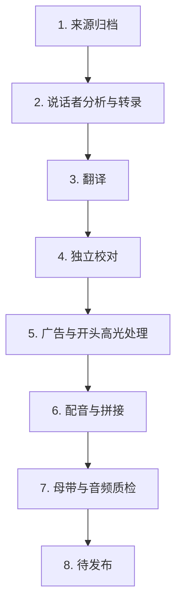

# TransPodcast

<p align="center">
  
</p>

<p align="center">
  <strong>播客翻译工具：将英文播客转译成中文播客，并保留说话人的音色与表达节奏。</strong>
</p>

<p align="center">
  <a href="README.en.md">English</a>
  ·
  <a href="https://github.com/socekin/TransPodcast/actions/workflows/ci.yml"></a>
  <a href="https://github.com/socekin/TransPodcast/actions/workflows/codeql.yml"></a>
  <a href="LICENSE.md"></a>
  
  
</p>

TransPodcast 面向希望用中文完整收听英文长播客的用户。支持导入 YouTube 播客链接，完成多人语音识别、全文翻译、中文配音和质量检查，最终生成可在 Apple Podcasts 等客户端订阅的私人中文播客。

> TransPodcast 仅用于学习、研究和技术实验。请勿处理或传播未经授权的内容，也不建议使用本项目公开发布翻译节目。


## 核心功能

- **🎧 完整节目转译：** 将英文长播客转录、翻译并合成为完整的中文音频，而不是仅生成摘要或文字稿。
- **👥 多人声音还原：** 识别节目中的不同说话人，并在中文版本中分别保留其音色特征和表达方式。
- **✍️ 翻译与审校：** 结合完整上下文翻译对话，并通过独立审校检查术语、数字、语义和口语表达。
- **✂️ 广告与开头高光移除：** 识别可明确分离的第三方付费广告和拼接式开头高光，不将其纳入最终中文音频；不确定内容会保留，避免误删正文。
- **🔎 节目发现与筛选：** 支持 YouTube 频道和单集 URL，可依据个人兴趣自动筛选值得处理的节目。
- **🗣️ 频道声音库：** 持续积累已确认的说话人声音，在同一频道的后续节目中复用。
- **🖥️ 本地 Web 管理界面：** 通过 TransPodcast Host 管理节目库，查看处理进度、失败原因、修订记录和发布状态。
- **♻️ 可恢复的长任务：** 长节目在处理中断后可从最近完成的阶段继续，避免整期重新处理。
- **✅ 发布前试听：** 中文成片先进入私人试听，确认翻译、发音和音频质量后再发布。
- **📡 私人播客订阅：** 生成受保护的 RSS feed，可通过 URL 添加到 Apple Podcasts 等播客客户端。
- **🔔 可选 Telegram 通知：** 在节目等待确认、处理失败或发布完成时发送通知。

## 效果试听

以下样例选取相同的 20–30 秒内容，对比英文原声与 TransPodcast 生成的中文成片。

| 来源节目 | 英文原声 | 中文成片 |
| --- | --- | --- |
| [All-In Podcast：Google's AI Brain Drain, SpaceX's Huge Quarter…](https://www.youtube.com/watch?v=muRIXCDw-k0) | [▶ 试听原声（28 秒）](https://socekin.github.io/TransPodcast/audio/all-in-ai-talent-spacex-saas/original.en.mp3) | [▶ 试听中文成片（23 秒）](https://socekin.github.io/TransPodcast/audio/all-in-ai-talent-spacex-saas/rendered.zh-CN.mp3) |
| [Lenny's Podcast：The playbook for building high talent density teams](https://www.youtube.com/watch?v=zegYJ6dhIg4) | [▶ 试听原声（27 秒）](https://socekin.github.io/TransPodcast/audio/lenny-talent-density-adam-ward/original.en.mp3) | [▶ 试听中文成片（22 秒）](https://socekin.github.io/TransPodcast/audio/lenny-talent-density-adam-ward/rendered.zh-CN.mp3) |

片段来源、时间范围、文本与翻译见 [Audio Comparisons](docs/audio-comparisons.md)。

## 当前已知问题

- **多人重叠语音：** 多位说话人同时发声时，说话人归属、语音分离和中文配音衔接可能不准确。
- **笑声：** 笑声和带笑语气可能在转录与语音合成过程中被弱化或丢失，生成音频的自然度会低于原节目。

## 部署要求

| 类别 | 要求 | 用途 |
| --- | --- | --- |
| 本地运行主机 | 一台可持续运行的 macOS 设备 | 运行 TransPodcast、保存本地数据并提供管理界面 |
| 本地工具链 | Xcode Command Line Tools（提供 Git 与 make）、Python 3.12–3.14、[uv](https://docs.astral.sh/uv/)、Node.js 22+、npm、FFmpeg | 安装、构建和运行项目 |
| Codex CLI（必需） | 已安装并完成认证的 [Codex CLI](https://developers.openai.com/codex/cli) | 节目筛选、翻译、审校和节目文案生成 |
| GPU 语音服务 | Modal 账号 | 语音识别、说话人分析和中文语音合成 |
| 私人播客发布 | Cloudflare 账号、R2 bucket、Worker 和稳定的 HTTPS 域名 | 托管受保护的 RSS feed 与完整节目音频 |
| 播客客户端 | Apple Podcasts 或其他支持通过 URL 添加 feed 的客户端 | 订阅私人中文播客 |
| 使用范围 | 仅处理可合法使用的内容 | 本项目仅供学习、研究和技术实验，不应处理或传播未经授权的内容 |
| 可选通知 | Telegram Bot Token 与 Telegram Chat ID | 接收处理和发布状态通知 |

私人订阅只需要 Apple Podcasts app 和可访问的 RSS URL，不需要 Apple Podcasts Connect 账号。完整说明见 [Apple Podcasts and Private RSS](docs/publishing/apple-podcasts.md)。

## 使用 Agent 部署

部署 Agent 应首先读取以下文档：

[Agent Deployment Brief](docs/agent-deployment.md)

可直接向 Agent 提交以下指令：

```text
Read docs/agent-deployment.md first, then follow the linked setup and
deployment docs. Do not call live providers, deploy infrastructure, publish
media, rotate secrets, or change tokens until I explicitly approve that step.
First report what prerequisites are missing and what commands you plan to run.
```

该文档定义了部署顺序、验证标准、需要明确批准的操作，以及 `.env`、私人 feed URL、账号 ID、源音频、转录文本和生成音频的安全边界。

## 安装与启动

```shell
git clone https://github.com/socekin/TransPodcast.git
cd TransPodcast
make setup
make check
cp .env.example .env
make dev
```

TransPodcast Host 默认地址：<http://transpodcast.localhost:8000>。

上述命令完成依赖安装、项目检查和本地服务启动。后台服务会检查已配置的 Codex、Modal、Cloudflare、Telegram 和 YouTube 能力是否就绪，因此启动后可能产生 provider API 请求；默认手动处理模式不会自动导入节目、启动处理任务或运行 GPU 语音阶段。实际节目处理需要继续完成 [Getting Started](docs/getting-started.md) 中的服务配置。

## 处理与发布流程

1. 按 [Getting Started](docs/getting-started.md) 完成本地环境和服务配置。
2. 按 [Deployment](docs/deployment/README.md) 配置运行 TransPodcast 的 Mac、Modal 语音应用，以及远程收听所需的 Cloudflare publication Worker。
3. 在 TransPodcast Host 中添加用于学习或研究的 YouTube 频道或单集 URL。
4. 启动处理任务，并查看各阶段的进度、重试和修订记录。
5. 完整收听私人试听版本，检查翻译、说话人、发音和音频质量。
6. 完整试听并确认节目元数据后，人工发布到私人 RSS feed。
7. 使用私人 RSS URL 在 Apple Podcasts 或其他播客客户端中订阅。

## 处理 Pipeline



这些节点与 TransPodcast Host 的运行记录一致。运行记录会保留阶段状态和尝试历史，任务中断后可从最近的有效检查点恢复。节目通过母带与音频质检后进入待发布状态，由用户完整试听并人工确认后写入私人 RSS feed。

运行 TransPodcast 的 Mac 即 TransPodcast Host，负责保存工作状态、协调各处理阶段并提供本地 Web 管理界面。计算密集型语音任务在 Modal 上运行；私有 R2 存储和 Cloudflare Worker 负责提供受保护的 RSS 与节目音频。Telegram 仅作为可选通知渠道。

## 开源与开放权重模型

TransPodcast 组合使用以下语音模型。模型权重不包含在本仓库中，其许可条款独立于 TransPodcast 的软件许可。

| 模型 | 用途 |
| --- | --- |
| [NVIDIA Streaming Sortformer](https://huggingface.co/nvidia/diar_streaming_sortformer_4spk-v2.1) | 识别说话人及其发言时间范围 |
| [Qwen3-ASR](https://github.com/QwenLM/Qwen3-ASR) | 将英文语音识别为文字 |
| [Qwen3 ForcedAligner](https://huggingface.co/Qwen/Qwen3-ForcedAligner-0.6B) | 将文字与音频时间精确对齐 |
| [NVIDIA TitaNet](https://huggingface.co/nvidia/speakerverification_en_titanet_large) | 提取说话人声音特征并辅助身份匹配 |
| [IndexTTS2](https://github.com/index-tts/index-tts) | 生成带有目标音色和表达特征的中文语音 |

部署前请阅读 [Third-party Model Terms](docs/model-licenses.md)，并核对所用模型版本的许可、署名和使用限制。

## 文档索引

- [Agent Deployment Brief](docs/agent-deployment.md)
- [Getting Started](docs/getting-started.md)
- [Configuration](docs/configuration.md)
- [Deployment](docs/deployment/README.md)
- [Apple Podcasts and Private RSS](docs/publishing/apple-podcasts.md)
- [Architecture](docs/architecture.md)
- [Third-party Models](docs/model-licenses.md)
- [Troubleshooting](docs/troubleshooting.md)

## 获取帮助

- Email：<socekin@gmail.com>
- X / Twitter：[@jayfx42](https://x.com/jayfx42)

本仓库暂不接受 GitHub Issues 或外部代码贡献。

## 使用范围

TransPodcast 仅用于学习、研究和技术实验。请勿下载、翻译、合成或发布未经授权的内容，也不建议使用本项目公开传播翻译节目。使用者应遵守内容来源平台、模型和服务提供商的适用条款。

## 许可

TransPodcast 以 source-available 方式发布。个人及其他非商业用途适用 [PolyForm Noncommercial License 1.0.0](LICENSE.md)。

商业使用需要单独授权，请联系 Jay：<socekin@gmail.com>。详见 [COMMERCIAL_LICENSE.md](COMMERCIAL_LICENSE.md)。

## Credits

TransPodcast 建立在以下开源项目与开放模型贡献者的工作之上：

- [Qwen3-ASR](https://github.com/QwenLM/Qwen3-ASR)，由 Qwen 团队贡献语音识别与强制对齐模型。
- [NVIDIA NeMo](https://github.com/NVIDIA-NeMo/NeMo)，提供 Streaming Sortformer、TitaNet 及相关语音工具。
- [IndexTTS2](https://github.com/index-tts/index-tts)，提供可控的零样本语音合成能力。
- [FFmpeg](https://ffmpeg.org/) 与 [yt-dlp](https://github.com/yt-dlp/yt-dlp)，提供可靠的媒体获取与音频处理基础设施。

感谢这些项目的维护者、研究人员和社区贡献者。
