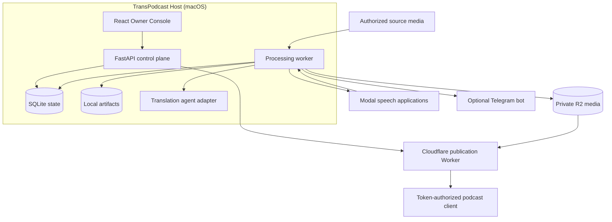
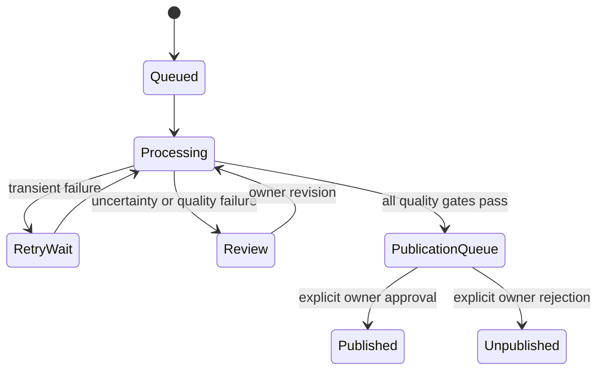

# Architecture

TransPodcast separates the durable workflow from provider execution and media
delivery. This makes provider failures resumable and keeps publication behind
an explicit owner decision.

## Components

`src/transpodcast/` contains the domain model, application service, persistence,
quality gates, processing worker, and provider interfaces. External behavior
enters through adapters so tests can replace it with deterministic fakes.

`apps/owner-console/` is the local React interface. It uses the FastAPI
contract and does not connect to providers or the database directly.

`experiments/pipeline/` contains the pinned Modal speech applications. The
directory name reflects their deployment model; active pipeline versions are
still production components and are versioned explicitly.

`workers/publication/` serves the private RSS feed and immutable media through
a token-protected Cloudflare edge. It has no workflow authority.

## Durable processing model

One accepted source creates a Processing Run. Each stage writes an immutable
checkpoint and a separate attempt record. A retry resumes from the latest
valid checkpoint. Provider output is validated before it can advance workflow
state.

## Trust boundaries

- Source metadata, captions, transcripts, and provider responses are untrusted
  inputs.
- The TransPodcast host is the workflow system of record.
- Modal receives only the media and metadata needed by the current operation.
- R2 stores immutable private publication objects; access is enforced at the
  publication Worker.
- Telegram transports bounded actions but is never the system of record.
- A quality result cannot publish an episode; only an owner decision can.

## Data retention

Runtime state, source archives, generated speech, previews, logs, and tokens
are deliberately excluded from Git. Operators are responsible for backups and
for deleting source or voice material when their authorization or retention
need ends.

See [Domain model](domain-model.md) for the repository's precise vocabulary.
